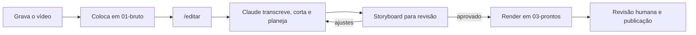

# Editor de Vídeo com IA

Transforme o Claude Code num editor de vídeo. Você grava do seu jeito, joga o arquivo numa pasta e pede a edição. O Claude corta as pausas, coloca legenda, efeitos sonoros e motion seguindo o seu estilo, mostra um storyboard para você aprovar e exporta o vídeo pronto.

> Projeto independente, sem vínculo com a Anthropic, a HeyGen ou os mantenedores das ferramentas usadas.

---

## O que o sistema faz

Este repositório é a pasta de trabalho do editor. Ela traz:

- **Instruções para o Claude** (`CLAUDE.md`), com a função de cada pasta e as regras de trabalho. O Claude Code lê esse arquivo sozinho sempre que você abre o projeto.
- **Dois comandos prontos** para usar no Claude Code:
  - `/estilo` estuda vídeos de referência e monta uma folha de estilo para você aprovar.
  - `/editar` edita o vídeo bruto como reel do Instagram seguindo essa folha.

Para editar, o Claude usa quatro ferramentas que você instala no computador:

| Ferramenta | Para que serve |
| --- | --- |
| [FFmpeg](https://github.com/FFmpeg/FFmpeg) | Corta, junta, converte e mixa áudio |
| [Whisper](https://github.com/openai/whisper) | Transcreve a fala e gera as legendas |
| [yt-dlp](https://github.com/yt-dlp/yt-dlp) | Baixa os vídeos de referência para estudo de estilo |
| [HyperFrames](https://github.com/heygen-com/hyperframes) | Motion, legendas animadas e render do vídeo |

No dia a dia, o fluxo fica assim:



---

## Requisitos

- Windows 10/11, macOS ou Linux
- [App desktop do Claude](https://claude.ai/download) com acesso ao Claude Code
- [Git](https://git-scm.com/downloads)
- [Node.js](https://nodejs.org) 22 ou mais recente
- [Python](https://www.python.org/downloads/) 3.10 a 3.12
- Espaço em disco para o Whisper e o modelo de transcrição (cerca de 2 GB)

---

## Tutorial

### 1. Baixe o projeto

Clone o repositório já com o nome da pasta do editor:

```bash
git clone https://github.com/<seu-usuario>/editor-de-video-com-ia.git "Editor de Video com IA"
cd "Editor de Video com IA"
```

Se preferir, clique em **Code > Download ZIP**, extraia e renomeie a pasta para `Editor de Video com IA`.

### 2. Crie as pastas

Abra um terminal dentro da pasta do projeto e rode o script do seu sistema.

**Windows (PowerShell):**

```powershell
"01-bruto","02-referencias","03-prontos","04-recursos","estilo","trabalho" |
  ForEach-Object { New-Item -ItemType Directory -Force -Path $_ | Out-Null }
Write-Host "Pastas criadas em $PWD"
```

**macOS e Linux:**

```bash
mkdir -p 01-bruto 02-referencias 03-prontos 04-recursos estilo trabalho
echo "Pastas criadas em $PWD"
```

O resultado é esta estrutura:

```
Editor de Video com IA/
├─ 01-bruto/         seus vídeos gravados (o Claude nunca altera estes arquivos)
├─ 02-referencias/   vídeos de referência baixados para estudo de estilo
├─ 03-prontos/       vídeos finalizados
├─ 04-recursos/      logo, fontes, trilhas e efeitos licenciados da sua marca
├─ estilo/           a sua folha de estilo
├─ trabalho/         arquivos temporários (transcrições, storyboards)
├─ .claude/          comandos /estilo e /editar
└─ CLAUDE.md         instruções que o Claude lê ao abrir o projeto
```

### 3. Instale as ferramentas

Instale cada ferramenta com o gerenciador de pacotes do seu sistema. No Windows, use o [winget](https://learn.microsoft.com/windows/package-manager/winget/), que já vem no Windows 10 e 11. No macOS, use o [Homebrew](https://brew.sh).

Depois de instalar, **feche e abra o terminal de novo** para o sistema reconhecer os novos comandos.

#### Node.js e Python

Base para o HyperFrames e o Whisper. Pule se já tiver as versões dos requisitos.

| Sistema | Comando |
| --- | --- |
| Windows | `winget install OpenJS.NodeJS.LTS` e `winget install Python.Python.3.12` |
| macOS | `brew install node python@3.12` |
| Linux | Python pelo gerenciador da distribuição; Node.js 22+ pelo [nvm](https://github.com/nvm-sh/nvm) ou pelo [site oficial](https://nodejs.org) (o pacote do `apt` costuma ser antigo) |

#### FFmpeg

| Sistema | Comando |
| --- | --- |
| Windows | `winget install Gyan.FFmpeg` |
| macOS | `brew install ffmpeg` |
| Linux (Debian/Ubuntu) | `sudo apt install ffmpeg` |

#### Whisper

| Sistema | Comando |
| --- | --- |
| Windows | `py -3.12 -m pip install -U openai-whisper` |
| macOS | `brew install openai-whisper` |
| Linux | `pipx install openai-whisper` |

O Whisper baixa o modelo de transcrição na primeira vez que é usado. Para adiantar esse download (cerca de 460 MB), rode:

```bash
python -c "import whisper; whisper.load_model('small')"
```

No Windows, troque `python` por `py -3.12`. No macOS e no Linux, se o comando der erro de módulo não encontrado, pule esta etapa: o download acontece na primeira edição.

#### yt-dlp

| Sistema | Comando |
| --- | --- |
| Windows | `winget install yt-dlp.yt-dlp` |
| macOS | `brew install yt-dlp` |
| Linux | `pipx install yt-dlp` |

#### HyperFrames

O HyperFrames entra no Claude Code como um conjunto de skills. Rode este comando **dentro da pasta do projeto**, para que as skills valham só para ele:

```bash
npx skills add heygen-com/hyperframes -s hyperframes hyperframes-cli hyperframes-registry media-use -a claude-code -y
```

O HyperFrames coleta dados de uso anônimos. Para desligar:

```bash
npx hyperframes telemetry disable
```

### 4. Confira a instalação

Rode cada comando abaixo. Todos devem responder com um número de versão ou um texto de ajuda, sem erro.

```bash
node --version
ffmpeg -version
whisper --help
yt-dlp --version
npx hyperframes --version
```

Se o `whisper` não for encontrado no Windows, teste `py -3.12 -m whisper --help`. Se esse funcionar, a instalação está certa: só a pasta de scripts do Python não está no PATH, e o Claude consegue usar o Whisper do mesmo jeito.

### 5. Abra a pasta no Claude Code

1. Abra o app desktop do Claude e faça login.
2. Vá em **Code**, escolha **Local** e selecione a pasta `Editor de Video com IA`.

A partir daí, o Claude consegue ler e gravar arquivos nessa pasta e usar as ferramentas instaladas.

### 6. Coloque os recursos da sua marca

Copie para `04-recursos` o que pode aparecer nos seus vídeos: logo, fontes, trilhas e efeitos sonoros com licença de uso, vinhetas e grafismos.

O Claude só usa no vídeo final o que estiver nessa pasta.

### 7. Crie a sua folha de estilo

Faça isso uma vez só. No chat do Claude Code, digite `/estilo` seguido de 3 a 5 links de vídeos com o estilo que você quer seguir. Podem ser vídeos seus ou de outro criador.

```
/estilo https://link-1 https://link-2 https://link-3
```

O Claude vai:

1. Baixar os vídeos para `02-referencias`.
2. Estudar o que eles têm em comum: fonte, cor e legenda; corte, zoom e ritmo; motion, música e som.
3. Escrever regras objetivas em `estilo/folha-de-estilo.md`, com escolhas próprias de fonte, cores e grafismos em vez de copiar a identidade visual dos criadores.
4. Mostrar um resumo e perguntar o que ajustar.

Peça as mudanças que quiser e, quando estiver bom, diga que aprova. A folha passa de `RASCUNHO` para `APROVADA`, e só a partir daí o `/editar` funciona.

### 8. Edite um vídeo

Grave do jeito que você sempre grava e coloque o arquivo em `01-bruto`. No Claude Code, digite:

```
/editar meu-video.mp4
```

Sem nome de arquivo, o Claude usa o vídeo mais recente da pasta.

O Claude vai:

1. Transcrever o áudio.
2. Cortar as pausas maiores que 0,15 segundo, além de erros e repetições.
3. Planejar legenda, efeitos sonoros e motion conforme a folha de estilo, no formato de reel do Instagram (vertical, 1080x1920).
4. Mostrar um storyboard com cada cena, o tempo, a fala e os efeitos.

### 9. Revise e exporte

Leia o storyboard e peça os ajustes como pediria a um editor: "tira o zoom da cena 3", "a legenda está grande demais", "corta a parte em que eu gaguejo no começo". Quando aprovar, o Claude renderiza e salva o vídeo em `03-prontos` com o nome `<arquivo>-reel.mp4`.

Assista ao vídeo inteiro antes de publicar. O Claude também lista os pontos que merecem atenção na revisão.

---

## Personalização

| O que mudar | Onde |
| --- | --- |
| Duração mínima da pausa cortada (padrão 0,15 s) | `.claude/commands/editar.md` |
| Formato de saída (reel, vídeo horizontal etc.) | `.claude/commands/editar.md` |
| O que o Claude analisa nas referências | `.claude/commands/estilo.md` |
| Regras gerais de trabalho e modelo do Whisper | `CLAUDE.md` |

O modelo `small` do Whisper é rápido e funciona bem na maioria das gravações. Se as legendas em português saírem com muitos erros, troque por `medium`, que é mais preciso e mais lento.

Pausas de 0,15 s deixam o ritmo bem acelerado. Se o vídeo ficar picotado, experimente 0,25 ou 0,3.

---

## Problemas comuns

**"Comando não encontrado" logo depois de instalar.** Feche e abra o terminal de novo. Se o Claude Code já estava aberto, feche e abra o app também, porque ele só enxerga os comandos que existiam quando foi iniciado.

**O `pip install` falha no macOS ou no Linux com a mensagem "externally-managed-environment".** O sistema protege o Python principal. Use o Homebrew (`brew install openai-whisper`) ou o `pipx`, como na tabela da etapa 3.

**Erro ao instalar as skills do HyperFrames.** Confira se o Git está instalado (`git --version`) e se o Node.js é 22 ou mais recente (`node --version`).

**O `/editar` não começa.** A folha de estilo ainda está como rascunho. Rode `/estilo`, revise e aprove.

**O Claude não encontra os comandos `/estilo` e `/editar`.** Confira se você abriu exatamente a pasta `Editor de Video com IA` no Claude Code, e não a pasta acima dela.

---

## Direitos autorais

Os vídeos de referência servem só para estudar ritmo, enquadramento, legenda e efeitos. O `CLAUDE.md` proíbe o Claude de reaproveitar trechos, músicas ou imagens deles no vídeo final. Material de terceiros só entra no vídeo se estiver em `04-recursos` e você tiver direito de uso.

Baixar vídeos de terceiros pode violar os termos de uso das plataformas. Use as referências com responsabilidade.

---

## Créditos

Este projeto não redistribui nenhuma das ferramentas abaixo. Cada uma tem a própria licença:

- [HyperFrames](https://github.com/heygen-com/hyperframes) (Apache 2.0)
- [FFmpeg](https://ffmpeg.org/legal.html) (LGPL/GPL)
- [Whisper](https://github.com/openai/whisper) (MIT)
- [yt-dlp](https://github.com/yt-dlp/yt-dlp) (Unlicense)

## Licença

Defina aqui a licença deste repositório.